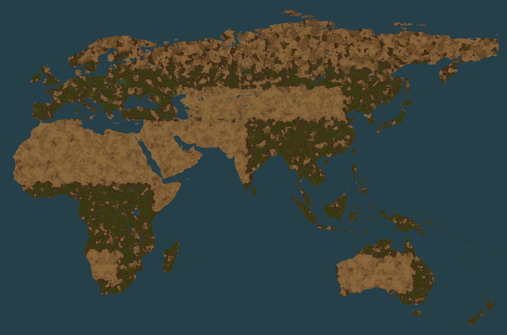

# Terra Nauvis

Terra Nauvis turns Nauvis into Earth. Pick one of three maps on the new-game screen and play on real
coastlines, with rivers your ships can sail, forests and deserts where you expect them, and a start
at a real city.

Version 0.1.0, for Factorio 2.1.

*Old World at map scale 6, seed 1000, from the game's map preview with the base game's tiles.*

## The three maps

| Preset | What it covers | World size at scale 1 | World size at scale 6 | Spawn cities |
|---|---|---|---|---|
| Terra Nauvis: Europe | Europe from Portugal to western Russia and Turkey, with a strip of North Africa | 2,400 x 1,704 tiles | 14,400 x 10,224 tiles | 40 |
| Terra Nauvis: Atlantic | The whole world, centred on the Atlantic | 15,689 x 6,524 tiles | 94,134 x 39,144 tiles | 50 |
| Terra Nauvis: Old World | Europe, Africa, Asia and Australia | 8,963 x 5,847 tiles | 53,778 x 35,082 tiles | 33 |

Every map sits in an endless deep ocean and comes with:

- Great rivers, straits and canals wide enough for ships, with walkable fords across the rivers.
- Earth climate: a frozen far north, cold Scandinavia and Russia, temperate Europe and hot deserts.
- Marshes and 16 great forests, from the Black Forest to the Congo and the Amazon on the maps that
  hold them.
- Cliff ridges along 16 mountain ranges, with passes at their historic crossings.
- Historic ore fields at their real sites, such as Kiruna, the Ruhr and Ghawar, with heavier biters
  around them.
- A spawn at the city you choose, or a random one, with land around it, a lake nearby, starting ore
  and no biters in the starting area.

*Europe at map scale 6, seed 1000.*

## Install

You need Factorio 2.1.24 or newer in the 2.1 series. Space Age is not required.

1. Download `terra-nauvis_<version>.zip` from the
   [latest release](https://github.com/jakemismas/terra-nauvis/releases/latest).
2. Put the zip in your mods folder. Do not unzip it, and keep only one `terra-nauvis_*.zip` there.
   - Windows: `%APPDATA%\Factorio\mods`
   - Linux: `~/.factorio/mods`
   - macOS: `~/Library/Application Support/factorio/mods`
3. Start Factorio, open **Mods**, check that Terra Nauvis is enabled, and confirm.

The release also carries `terra-nauvis_<version>.zip.sha256`, so you can check your download. The
repository's `latest` pre-release is a rolling build of the newest code: it changes on every push,
so use the tagged release to play.

## Start a world

1. In the main menu, open **Settings > Mod settings > Startup**.
2. Set **Map scale**. Scale 6, the default, is the largest world. Each value lists the world size of
   every map.
3. Set the spawn city for your map, such as **Spawn city: Old World**. Random picks a city from the
   map seed. Confirm, and let the game reload.
4. Open **Single player > New game**.
5. In the preset list at the top left, pick **Terra Nauvis: Old World**, or Europe or Atlantic. The
   preview shows the map around your spawn.
6. Press **Play**. The intro names your spawn city and the world size.

Set everything before you press Play. A world made from a preset keeps its scale, spawn city and
every startup setting below for life, and a message tells you when a setting no longer matches.

The Terrain tab's **Map type** list also names the three maps. Picking only the map type gives you
that map's coast, rivers and spawn with the base game's climate and none of the rest, and that world
follows later changes to the scale and spawn city settings, which moves any terrain it generates
afterwards. Use the preset unless you want exactly that.

## Settings

All of these are startup settings except City markers, which is on the Map tab.

| Setting | Default | What it does |
|---|---|---|
| Map scale | 6 | The size of the world: each pixel of the reference map becomes 1 to 6 tiles. |
| Spawn city: Europe | Random | Where a Europe game starts: Random or one of 40 cities. |
| Spawn city: Atlantic | Random | Where an Atlantic game starts: Random or one of 50 cities. |
| Spawn city: Old World | Random | Where an Old World game starts: Random or one of 33 cities. |
| Canals | On | Opens the Kiel and Corinth canals on every map, Suez on Atlantic and Old World, and Panama on Atlantic, as sea-level channels at least 7 tiles wide. Off keeps every isthmus closed. |
| Great forests | On | Gives the 16 great forests about twice the trees of the land around them. Trees still follow the climate. |
| Ridges | On | Places cliff ridges along 16 mountain ranges, the only cliffs on the map, with passes wide enough for a double track. Off gives a map with no cliffs. |
| Ore hotspots | On | Adds dense ore at historic sites, with about three times the base game's biter nests inside them, and offshore oil fields where the Oil Rig mod is installed. Off gives the base game's ore. |
| Inland lakes | Off | Scatters small random lakes across the land. Off leaves the lake at the spawn city, the rivers and the real lakes of the map. |
| Destroyed Europe | Off | Needs Alien Biomes. Turns the heart of Europe, from France to Warsaw and down to Ljubljana and about Rome, into a red wasteland of lava, black ash, red rock and scorched grass, with an outline that differs on every map seed. The start area stays normal. |
| Exact coastlines | On | On Atlantic and Old World it snaps a new world's coast to the reference map as chunks generate, so fjords, bays and islets come back. The new-game preview shows the coast before that, and land made from sea takes the trees and ground cover of the land beside it. Europe's map does not need it. |
| Destroyed Europe | Off | Needs Alien Biomes. Turns the heart of Europe, from France to Warsaw and down to Ljubljana and about Rome, into volcanic ground, hotter toward the middle, with an outline that differs on every map seed. The start area stays normal. |
| Exact coastlines | On | On Atlantic and Old World it holds a new world's coast to the reference map as chunks generate, on every continent alike, so fjords, sounds, channels and islets come back. The new-game preview shows the coast before that, and land made from sea takes the trees and ground cover of the land beside it. Europe's map keeps its noise coast. |
| City markers | Off | Names every city on the map view. It changes nothing in the world, so you can switch it at any time in a running game. Worlds made from a Map type entry alone get no markers. |

## Compatibility

- **Alien Biomes:** optional. With it, tiles and trees follow the Earth climate, and the base game's
  trees, rocks and plants grow beside Alien Biomes' own. Without it, the base game's tiles follow
  the climate. Destroyed Europe needs it.
- **Space Age:** works, and is not required. Terra Nauvis changes Nauvis only, so the other planets
  generate as they do without it.
- **RSO:** not supported. RSO replaces the starting ore and adds its own patches, so the start may
  not match the map, and the preview shows no ore. Ore hotspots and offshore fields stay. The game
  warns you at the start and carries on. Turn RSO off to get the designed start.
- **Cargo Ships and its Oil Rig:** rivers, straits and canals are wide enough for ships, and offshore
  oil fields appear on deep water when the Oil Rig mod is installed.
- **Large packs:** the maintainer's pack of 83 mods, with Space Age, Alien Biomes, RSO, Cargo Ships, Bob's
  Enemies, Big Monsters and Dectorio, ran with no errors, saved and reloaded clean, and gave the same
  world on four separate creates. Those mods change ore, enemies and looks, so a world in a pack
  will not match the previews on this page.

## Known limits

- **Multiplayer is untested.** No desync test has run, so 0.1.0 is for single player.
- **The water and cliffs sliders do not change an Earth map.** The coast stays, and ridges are the
  only cliffs. A world started with cliffs at none gets its ridges back beyond the starting area.
  The other map generation sliders work.
- **The new-game preview is small.** No mod can change its size, so it shows only the area around
  the spawn, never a whole map at a large scale.
- **A coast is as fine as its reference, and the preview is coarser.** The reference holds one
  pixel per 2.5 km or so, at every map scale and on every continent, so a world's coast follows it to
  within a tile or two and shows nothing finer. Islets under a pixel come from a vector coastline and
  are drawn a pixel wide. A channel narrower than a pixel is drawn as a thin channel where the
  reference shows one, and rivers and straits near a waterway keep the waterway's own line. The
  new-game preview shows the noise coast, which on Old World and Atlantic is coarser away from Europe
  than the world you get. Exact coastlines off leaves that noise coast in the world too.
- **New chunks cost more than in the base game,** and more again beside Alien Biomes. Noise adds
  nothing per tick once chunks exist. Terra Nauvis also adds a few seconds to the game's startup.
- **An existing save stays as it is.** Adding the mod to a world made without it changes nothing on
  that world's surfaces.
- **Testing was light for this release.** 0.1.0 passed load checks, spawn checks, a crash matrix, a
  pack run and one security pass. The full timing, determinism and save suites have not run on the
  final build.
- **Not on the Mod Portal.** The GitHub release is the only source.

## License and credits

Terra Nauvis is by Jake Mismas, under the GNU General Public License version 3: see
`terra-nauvis/LICENSE`, and `terra-nauvis/SOURCE-OFFER.txt` for how to get the source. Its map data
derives from [EarthMaps](https://github.com/HySpeed/EarthMaps) by HySpeed, also GPLv3. The islets the
EarthMaps raster lacks are derived from
[RESOLVE Ecoregions 2017](https://ecoregions.appspot.com/) by Dinerstein et al., CC BY 4.0.

## For developers

`python tools/earth_test.py static` runs the static checks and `python tools/build_zip.py` builds the
zip. `TESTING.md` is the release smoke test, `CHANGELOG.md` the build record, and `ARCHITECTURE.md`
and the design notes hold the design.
