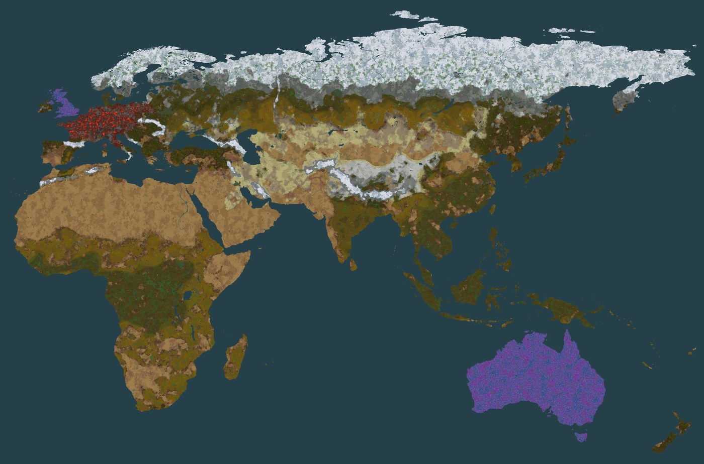
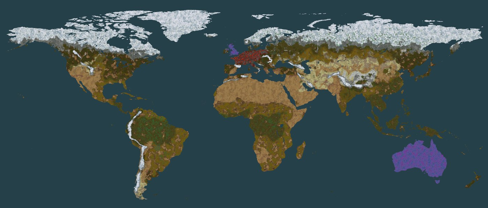

# Terra Nauvis

Terra Nauvis turns Nauvis into Earth. Pick one of three maps on the new-game screen and play on real
coastlines, with great rivers, forests and deserts where you expect them, and a start at a named city.

Version 0.3.0, for Factorio 2.1.

*Old World at map scale 6: 53,778 x 35,082 tiles, seed 1000, spawn Frankfurt, beside Alien Biomes
with Destroyed Europe and Blue corrupted UK and Australia on.*

The whole-map images on this page are the game's own map preview, read every few tiles across the
whole map and averaged down. They show the tiles and trees the game places; biter bases, rocks and
cliffs are left out, since at this size they would be drawn far too large.

## The three maps

World sizes are in tiles.

| Preset | What it covers | Scale 1 | Scale 6 | Scale 12 | Scale 24 | Spawn cities |
|---|---|---|---|---|---|---|
| Terra Nauvis: Europe | Europe from Portugal to western Russia and Turkey, with a strip of North Africa | 2,400 x 1,704 | 14,400 x 10,224 | 28,800 x 20,448 | 57,600 x 40,896 | 40 |
| Terra Nauvis: Atlantic | The whole world but Antarctica, centred on the Atlantic | 15,689 x 6,524 | 94,134 x 39,144 | 188,268 x 78,288 | 376,536 x 156,576 | 50 |
| Terra Nauvis: Old World | Europe, Africa, Asia and Australia | 8,963 x 5,847 | 53,778 x 35,082 | 107,556 x 70,164 | 215,112 x 140,328 | 33 |

Scales 2 to 5 fall in between: at scale N each pixel of the reference map becomes N by N tiles.

*Old World at map scale 12: 107,556 x 70,164 tiles, seed 1000, spawn Frankfurt.*

*Old World at map scale 24: 215,112 x 140,328 tiles, seed 1000, spawn Frankfurt. Each pixel of this
image covers about 160 tiles each way.*

Every map sits in an endless deep ocean and comes with:

- Great rivers with walkable fords, and straits and canals wide enough for ships. Rivers narrow with
  the map scale, from about 3 tiles wide at scale 1 to about 12 to 18 at scale 6, the scale ships
  need.
- Earth climate: the far north under snow and ice, from northern Russia across Siberia, with grey
  wasteland leading in; forest across Russia's main lowland, temperate Europe and hot deserts.
- Marshes and 16 great forests, from the Black Forest to the Congo and the Amazon on the maps that
  hold them.
- Cliff ridges along the map's mountain ranges (9 on Europe, 13 on Old World, 16 on Atlantic), with
  passes at their historic crossings. Big rocks and stony ground gather round each range, and
  tall ranges turn to grey rock and snow in whole massifs at every scale.
- Regular ore in lobed fields of many sizes, gathered in provinces, and historic ore fields at their
  real sites, such as Kiruna, the Ruhr and Ghawar, with heavier biters around them. A historic
  field's ore is at least as rich per tile as the ordinary ore around it, and a place holds the same
  ore per tile at scales 6, 12 and 24.
- Biter bases scattered over the land rather than standing in even rows.
- A spawn at the city you choose, or a random one, with land around it, a lake nearby, starting ore
  and no biters in the starting area. A city in the snow starts in a clearing of bare ground.
- Bays and headlands where a map's frame cuts through land, instead of a straight cut.

*Atlantic at map scale 6: 94,134 x 39,144 tiles, seed 1000, spawn Prague, beside Alien Biomes with
Destroyed Europe and Blue corrupted UK and Australia on.*

*Europe at map scale 6, seed 1000.*

## Install

You need Factorio 2.1.24 or newer in the 2.1 series. Space Age is not required.

1. Download `terra-nauvis_<version>.zip` from the
   [latest release](https://github.com/jakemismas/terra-nauvis/releases/latest).
2. Put the zip in your mods folder. Do not unzip it, and keep only one `terra-nauvis_*.zip` there.
   - Windows: `%APPDATA%\Factorio\mods`
   - Linux: `~/.factorio/mods`
   - macOS: `~/Library/Application Support/factorio/mods`
3. Start Factorio, open **Mods**, check that Terra Nauvis is enabled, and confirm.

The release also carries `terra-nauvis_<version>.zip.sha256`, so you can check your download. The
repository's `latest` pre-release is a rolling build of the newest code: it changes on every push,
so use the tagged release to play.

## Start a world

1. In the main menu, open **Settings > Mod settings > Startup**.
2. Set **Map scale**. Scale 6 is the default. Scales 12 and 24 make the largest worlds, two and four
   times as wide as scale 6; Exact coastlines does not run there, and every trip is long (Base game
   limits has the distances). Each value lists the world size of every map.
3. Set the spawn city for your map, such as **Spawn city: Old World**. Random picks a city from the
   map seed. Confirm, and let the game reload.
4. Open **Single player > New game**.
5. In the preset list at the top left, pick **Terra Nauvis: Old World**, or Europe or Atlantic. The
   preview shows the map around your spawn.
6. Press **Play**. The intro names your spawn city and the world size.

Set everything before you press Play. A world made from a preset keeps its scale, spawn city and
every startup setting below for life, and a message tells you when a setting no longer matches,
except Ore hotspot amount, which gives none.

The Terrain tab's **Map type** list also names the three maps. Picking only the map type gives you
that map's coast, rivers and spawn with the base game's climate and none of the rest, and that world
follows later changes to the scale, spawn city, Canals, Inland lakes and Ore hotspots settings,
which moves any terrain it generates afterwards. Use the preset unless you want exactly that.

## Recommended settings

A suggestion, not a default: set **Ore hotspot amount** to 200 percent, and on the new-game screen's
Resources tab lower each ore's **Frequency** from the preset's 75 percent to 50 percent. The ore near
home thins out and the historic fields hold twice their ore, so the real deposits become the places
worth reaching. The mod's own default for the hotspot amount stays at 100 percent.

## Settings

All of these are startup settings except City markers, which is on the Map tab.

| Setting | Default | What it does |
|---|---|---|
| Map scale | 6 | The size of the world: each pixel of the reference map becomes 1 to 6, 12 or 24 tiles. |
| Spawn city: Europe | Random | Where a Europe game starts: Random or one of 40 cities. |
| Spawn city: Atlantic | Random | Where an Atlantic game starts: Random or one of 50 cities. |
| Spawn city: Old World | Random | Where an Old World game starts: Random or one of 33 cities. |
| Canals | On | Opens the Kiel and Corinth canals on every map, Suez on Atlantic and Old World, and Panama on Atlantic, as sea-level channels at least 7 tiles wide that Cargo Ships can use. Off keeps every isthmus closed. |
| Great forests | On | Gives the map's great forests (9 on Europe, 14 on Old World, 16 on Atlantic) about twice the trees of the land around them, and the cold taiga forests more. Trees still follow the climate, so a forest in a dry place stays thinner. |
| Ridges | On | Places cliff ridges along the map's mountain ranges (9 on Europe, 13 on Old World, 16 on Atlantic), the only cliffs on the map, with passes at their historic crossings and a gap at least every 400 km, each wide enough for a double track. No ridge crosses the starting area. Off gives a map with no cliffs. |
| Ore hotspots | On | Adds dense ore at historic sites, across a footprint that moves a little with the map seed, with about three times the base game's biter nests inside it, and offshore oil fields on deep water where the Oil Rig mod is installed. On a solid ore field the map's size slider scales its area and total and the richness slider its ore per tile, the frequency slider does not reach it, and crude oil hotspots take only Ore hotspot amount. Ordinary ore stays out of a hotspot's disc. No field lies at a spawn city. Off gives the base game's ore, in the map's lobed fields. |
| Ore hotspot amount | 100 percent | How much ore and oil every hotspot holds: 50, 100, 200 or 400 percent. On a solid ore field more percent adds ore bodies inside its footprint instead of richness; oil wells grow richer. It never moves a hotspot or its footprint. |
| Inland lakes | Off | Scatters small random lakes across the land, away from coasts and the starting area. Off leaves only the lake at the spawn city, the rivers and the real lakes of the map. |
| Destroyed Europe | Off | Needs Alien Biomes. Turns the heart of Europe, from France across Germany and Poland to Ljubljana and down Italy to about Rome, into a red wasteland: a heart of cracked basalt with lava pools, volcanic rock and dead trees, with patches of black and grey rock, and where the zone meets land a broad barrier of scorched red grass, black ash and red rock that frays into normal ground. It runs to the shore on every coast. All of it can be walked and built on at full speed, and it absorbs pollution like grass. Biter and worm creep and the light brown mud and dry plants inside take a dark ember red. The outline differs on every map seed and the zone shows red on the map view. On new worlds a great forest inside the zone stands as a dead forest. Britain, Denmark, the Kiel Canal and the Carpathians stay outside. A chosen spawn city inside the zone starts in it, on cooler ground with its starting ore; a random one never lands inside. Without Alien Biomes nothing changes and the game warns. |
| Blue corrupted UK and Australia | Off | Needs Alien Biomes. Turns the UK and Australia into Alien Biomes' blue and purple lands: mostly mauve grass, with blue grass, purple grass and purple dirt mixed in, and the violet, white and blue trees and plants that grow there. Europe holds the UK alone. In Ireland the zone stops at the border of Northern Ireland, which frays into normal ground. On new worlds Alien Biomes' blue and purple lands appear nowhere else, with this setting on or off, and Alien Biomes' green and olive plants do not grow inside the zone. Biter and worm creep and the brown plants and mud inside take a blue-purple. |
| Exact coastlines | On | On Atlantic and Old World at map scales 1 to 6 it holds a new world's coast to the EarthMaps reference as chunks generate, except beside rivers, straits and canals, in the map's edge band and within 24 tiles of the spawn, so channels and islets narrower than a pixel come back, and land made from sea takes the trees and ground cover of the land beside it. The map preview still shows the noise coast. Europe's map and map scales 12 and 24 keep their noise coast, and a world made from a Map type entry alone gets none of this. |
| City markers | Off | Names every city on the map view. It changes nothing in the world, so you can switch it at any time in a running game. Worlds made from a Map type entry alone get no markers. |

## Compatibility

- **Alien Biomes:** optional. With it, the ground follows real regions: deep green rainforests,
  golden deserts, pale sand and gravel across Central Asia, dry yellow steppes, cold grey Tibet,
  a snowbound north and a white Greenland. Temperate Europe keeps its ground, and the base game's
  trees, rocks and plants grow beside Alien Biomes' own. Palms keep to warm, low ground south of about
  35.5 degrees north, and on new worlds they also grow in groves on warm Mediterranean shores, from
  Spain to Greece and Turkey's south coast; inland Europe has none. On new worlds Alien Biomes' blue,
  teal and purple ground, trees and plants grow only inside the Blue corrupted zone; everywhere else a
  blue tile gives way to a green, brown or orange one. Without Alien Biomes, the base game's tiles
  follow the climate, and a frozen tile of Terra Nauvis's own covers the north and the massifs.
  Destroyed Europe and Blue corrupted UK and Australia need it.
- **Grey cliffs beside Alien Biomes:** with Terra Nauvis and Alien Biomes both on, the cliffs of every
  Nauvis world use Alien Biomes' grey stone art: Terra Nauvis worlds, default worlds and older saves
  alike. It changes the look only, and no cliff moves.
- **Space Age:** works, and is not required. Terra Nauvis changes Nauvis only, so the other planets
  generate as they do without it. The one difference seen is a single plant on Gleba, which the game
  moves in any save whose Nauvis differs from the default. Playing with Space Age and big packs, below,
  has more.
- **RSO:** not supported. RSO replaces the map's ore with its own, so you do not get the designed
  start ore, ore hotspots may not match the map, and the preview shows no ore. Where RSO's start is
  short of an ore, Terra Nauvis adds a patch, unless RSO's Ore in starting area setting is off. The
  game warns you at the start and carries on. Turn RSO off to get the designed start.
- **Cargo Ships and its Oil Rig:** straits and canals are wide enough for ships at every scale, and
  carved rivers at scale 6; Known limits says which rivers Atlantic carves. Offshore oil fields
  appear on deep water when the Oil Rig mod is installed.
- **Large packs:** a world in a pack will not match the previews on this page, since packs change ore,
  enemies and looks. The next part says how.

## Playing with Space Age and big packs

0.3.0 was run with a pack of 82 mods: Space Age with Quality, Elevated Rails and Recycler, Alien
Biomes, Cargo Ships with its Oil Rig, Bob's Enemies, Big Monsters, Combat Mechanics Overhaul,
Dectorio, an admin tools mod and a set of graphics and quality-of-life mods, with RSO off. It loaded
with no errors, new Old World worlds at scales 6, 12 and 24 and Atlantic worlds at scale 6 were
created and run with no errors, ten game minutes ran clean, and a long run of travel, saves and loads
stayed stable.

- **The terrain stays the same.** In the map preview the coasts, rivers, ground and trees of a world in
  the pack match a world made beside Alien Biomes alone, pixel for pixel. Only ore and biter bases
  differ.
- **Ordinary ore moves.** The Oil Rig adds a set of ore patches of its own, so every ordinary patch
  lands somewhere else for the same seed. Every start city still gets all of its starting ore, and
  offshore oil fields appear on deep water. Offshore oil keeps the Oil Rig's own richness, which grows
  with distance, so at scales 12 and 24 it runs richer than at 6.
- **Biter bases change their look, not their place.** Bob's Enemies puts its own spawners where the
  base game's would stand, and its worms and Big Monsters' worms follow the same layout, so they stand
  scattered too.
- **Sand-coloured rocks on snow are Bob's Enemies' worm bile.** Its worms leave clusters of hardened
  bile 30 to 60 tiles around them. The bile looks like sand-coloured rocks and stands out on snow, and
  it belongs to Bob's Enemies, not to the terrain.
- **Graphics mods repaint, they do not move.** A terrain or decoration graphics mod changes how tiles,
  rocks and plants look; the shapes stay.
- **Gleba keeps its decoratives.** With Alien Biomes and Space Age together, 0.2.0 kept one mud decal
  off Gleba. 0.3.0 gives it back.
- **Memory.** A graphical game with this pack used about 12 GB on a fresh map, and every 180,000
  generated chunks (a square about 13,600 tiles wide) add about 4.5 GB.
- **Multiplayer.** A dedicated server and one client, both running the pack, played 15 minutes of
  Old World at scale 6 with the client covering about 10,000 tiles along the coast: no desync and no
  script error.

## Known limits

- **Multiplayer has had one kind of test.** A dedicated server and one client, both with an 82-mod
  pack, ran 15 minutes with no desync (Playing with Space Age and big packs has the details). Larger
  games and longer sessions are untested.
- **RSO is not supported for the designed start ore.** With RSO on you get RSO's start, not the one
  the map was built around. Compatibility has the details.
- **The water and cliffs sliders do not change an Earth map.** The coast stays, and ridges are the
  only cliffs. A world started with cliffs at none gets its ridges back beyond the starting area.
  On solid ore hotspots the size slider scales a field's area and total and the richness slider its
  ore per tile; the frequency slider does not reach them, and crude oil hotspots take only the Ore
  hotspot amount setting. The other map generation sliders work.
- **Europe's map has the weakest coast of the three.** Exact coastlines does not run on it, so it
  keeps its noise coast, which strays further from the reference than the coasts of Old World and
  Atlantic. Old World gives you a closer Europe.
- **Coasts at scales 6 and 24 are as in 0.2.0, and 12 is only a little better.** At scale 6 some
  coasts that Exact coastlines writes still step in squares along the reference's pixel edges, at
  Calais, Brittany, the Cotentin and Sydney among others. At 12 and 24, where Exact coastlines does
  not run, a coast can step at an even interval of 12 or 24 tiles, and a fold of the coast's wander
  can leave a tiny islet of a few tiles off a headland. At 12 river banks and ford ends now wander
  more, but straight runs of 7 to 10 tiles remain on the Rhine and the Thames. At 24 the Rhine near
  Koblenz keeps a long straight bank, and its fords there show as straight-sided pale shallow slabs.
- **Coasts and rivers at scales 1 and 2 are smoother, not perfect.** New worlds lose 0.2.0's square
  islets and slabs at Zeeland and Mont-Saint-Michel and most of the square steps along coasts and
  river banks. A straight run of 8 to 11 tiles still shows here and there, thin features such as
  Zeeland's narrow islands merge or thin, small islets such as Mont-Saint-Michel are gone, a channel
  the map draws straight stays straight (the Nieuwe Waterweg at scale 2, the Thames strait on Atlantic
  at scale 1), and a few ponds of 5 to 16 tiles appear where the reference holds a lake under a pixel
  or two.
- **A coast is as fine as its reference.** The reference holds one pixel per 2.5 km or so, at every
  map scale and on every continent, so a written coast follows it to within a tile or two and shows
  nothing finer. Islets under a pixel are drawn a pixel wide. A channel narrower than a pixel opens
  only where the reference shows one, and the coast beside a river or strait keeps the noise's line.
- **Written coast can stay bare in places.** Land Exact coastlines writes copies the trees and ground
  cover of the land beside it. A chunk with no land of its own copies a neighbour, so if that
  neighbour generates later, the new land stays bare. Written land holds no ore or biter bases
  either, so where it fills sea beside an ore field the field ends in a straight line at the old
  coast, as Batu Hijau's copper does at scale 6.
- **Worlds made before 0.3.0 keep 0.2.0's terrain.** Their biter bases stay in even rows, their ore is
  richer per tile at scales 12 and 24 than at 6 (about four times at 24), Moscow and much of Russia
  stay under snow, so a spawn there can stand on snow, their Mediterranean coast has no palms, and
  beside Alien Biomes they keep its blue and purple ground outside the Blue zone. Start a new world to
  get 0.3.0's terrain.
- **Atlantic worlds made before 0.2.0 keep broken great rivers at scale 3 and up.** New Atlantic worlds
  carve all 32 rivers at every scale, the Amazon, Mississippi, Nile, Congo and six more from their
  upper reaches to the sea. A world made before 0.2.0 keeps its terrain, so there those ten stay short
  pieces. A tributary the reference draws ends a few dozen tiles short of the river it joins.
- **Ships need scale 6 on rivers.** Rivers at scales 1 to 3 are too thin for ships, and scales 4 and
  5 were not checked. At every scale a river thins to a stream at its source.
- **Some shapes still read as computer-made.** Up close a ridge has short hooks, and where it bends hard
  a line can fold into a short gate or near ring. A wide range shows a main line and a side line running
  together. Greenland and Arctic Canada read as long east-west streaks. In the far north, snow and ice
  can meet in straight seams up to about 65 tiles long, and beside Alien Biomes the base game's
  sand-coloured rocks and decals also lie on dry snow there. Worlds made before 0.2.0 keep their
  older ridges, in near-parallel rows, and the Alps' sharper snow seam.
- **Destroyed Europe has blocky edges in places.** On the Europe map at scale 6 the zone's ground meets
  dark ground in stepped blocks at Calais and in Brittany, and the Calais shore runs straight for about
  25 tiles. A small patch of the zone's red rock ground can show straight sides, as at Calais at scale 6
  and in the Alps at scale 24.
- **Biter bases can still pair up.** Two spawners can stand side by side, and worms can line up loosely
  inside one base. New worlds have about 60 percent of 0.2.0's spawners.
- **Hotspot fields at scale 24 show their outline.** Trees and plants thin out on hotspot ore, so at
  scale 24 a field's edge reads as long, gentle arcs.
- **A few rivers break for a short stretch.** At some seeds and scales a short upper piece of a river stands
  apart from the rest, the Neman at Atlantic scale 2 and Old World scale 5, the Guadalquivir at Old World scale
  4, the Euphrates or the Neman at some seeds at scale 6. A thin channel opened from the sea can end
  abruptly about 240 tiles inland at scale 6.
- **New chunks cost more than in the base game.** On Old World at scale 6, at Frankfurt, generating
  chunks with 0.2.0 took 1.054 times as long as the base game, and beside Alien Biomes 1.078 times as
  long as Alien Biomes alone. 0.3.0 adds some work per chunk for ore, palms and biter bases, and at
  scales 1 and 2 Exact coastlines takes about 2.8 times as long per chunk as in 0.2.0, on worlds with
  far fewer chunks. Moving fast into new land can bring brief stalls. Nothing runs per tick once
  chunks exist. Terra Nauvis also adds a few seconds to the game's startup.
- **An existing save stays as it is.** Adding the mod to a world made without it changes nothing on
  that world's surfaces, apart from the grey cliff art beside Alien Biomes.
- **A default world beside Alien Biomes changes slightly.** With Terra Nauvis loaded, a new world on the
  default preset beside Alien Biomes has the same tiles, but about one tree in a hundred is another
  Alien Biomes species and a few decals move.
- **Testing.** 0.3.0 ran the pack soak (far travel, long simulation, save and load) on Old World at
  scale 6, created and ran 48 new worlds (the three maps at scales 1, 6, 12 and 24, with and without
  Alien Biomes and Destroyed Europe), and loaded 27 saves made with 0.1.x and 0.2.0 with not one tile
  or entity of their terrain moved.
- **Most cities stand where EarthMaps put them.** On Atlantic and Old World a city sits at EarthMaps'
  own map point, which can lie far from the real place it names. Prague, Frankfurt, Aachen and
  Moscow on Old World stand at their real positions.
- **Not on the Mod Portal.** The GitHub release is the only source.

## Base game limits

These come from Factorio itself, and no mod can change them.

- **Square tiles.** Coasts, rivers and borders are drawn in square tiles, so a diagonal edge steps one
  tile at a time.
- **Hard map edges.** The map does not wrap around: its far east and far west never meet, and past the
  reference map's frame lies endless deep ocean. On Atlantic the Pacific is cut in two at the map's
  ends.
- **Long distances at large scales.** In a straight line Moscow lies about 7,960 tiles from Frankfurt at
  scale 6, about 15,900 at scale 12 and about 31,800 at scale 24. At the base running speed of about 9
  tiles a second that is about 15, 30 and 60 minutes on foot.
- **Save size and memory.** The game keeps every generated chunk in the save and in memory. A square
  of about 13,600 tiles round the spawn, 180,000 chunks, saves to about 220 MB and holds about 4.5 GB
  of RAM in a big pack. A whole Old World holds about 1.8 million chunks at scale 6 and 29 million at
  scale 24, so a game only ever generates a small part of it.
- **No elevation.** The game has no height. Mountains show as rock and snow ground with cliff ridges
  and passes, never as hills.
- **Still water.** Water does not flow, so a river is a channel of still water.
- **Biters expand anyway.** Biter expansion follows the base game's map settings, so new bases spread
  onto land Terra Nauvis left free, the starting area included, unless expansion is off.
- **The new-game preview is small.** No mod can change its size, so it shows only the area around the
  spawn, never a whole map at a large scale.
- **The new-game preview cannot show Exact coastlines.** Exact coastlines is a script that runs as
  chunks generate, and no mod can run a script on that screen, so Old World and Atlantic show their
  noise coast there, coarser than the world you get, most of all away from Europe. At scales 12 and
  24, and with Exact coastlines off, the noise coast is the world's coast.
- **Worlds keep their terrain version for life.** A chunk the game has generated stays as it is, so a
  world has to keep making new chunks the way it began. A world made from a preset keeps the terrain
  of the version it was started on, and later versions change only new worlds. A world made from a
  Map type entry alone follows the scale, spawn city, Canals, Inland lakes and Ore hotspots settings
  instead.

## License and credits

Terra Nauvis is by Jake Mismas, under the GNU General Public License version 3: see `LICENSE` and
`NOTICE.md`, and `terra-nauvis/SOURCE-OFFER.txt` for how to get the source. Its maps derive from
[EarthMaps](https://github.com/HySpeed/EarthMaps) by HySpeed, also GPLv3. Forests, marshes and islets
derive from [RESOLVE Ecoregions 2017](https://ecoregions.appspot.com/) by Dinerstein et al., under
[CC BY 4.0](https://creativecommons.org/licenses/by/4.0/). Canal routes use data
(c) [OpenStreetMap](https://www.openstreetmap.org/copyright) contributors, under the Open Database
License. Base game expression texts in `terra-nauvis/prototypes/tables/vanilla.lua` belong to Wube
Software and are not under the GPL.

The hotspots' places and sizes are facts, listed with their sources in `data-src/hotspots/deposits-research.md`. Its
country tables quote the USGS Mineral Commodity Summaries 2026 data release, a United States government work in the
public domain. No dataset ships in the mod. Factorio is a trademark of Wube Software Ltd.; this is an unofficial mod.

## For developers

`python tools/earth_test.py static` runs the static checks and `python tools/build_zip.py` builds the
zip. The offline body checks and `build_zip.py --release` read `tests/vanilla-raw.json`, the base game's prototypes: `python tools/make_vanilla_raw.py --dump <base-only data-raw-dump.json>` makes it from an installed Factorio 2.1.
`TESTING.md` is the release smoke test, `CHANGELOG.md` the build record, and `ARCHITECTURE.md`
and the design notes hold the design.
