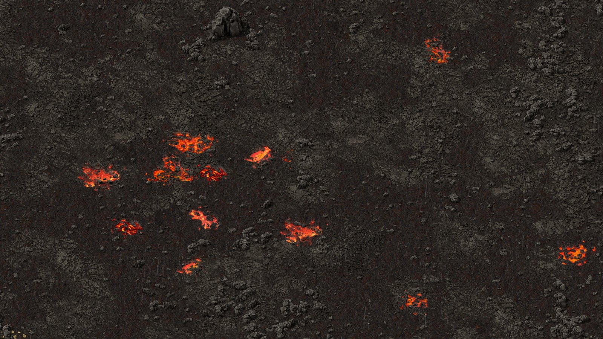
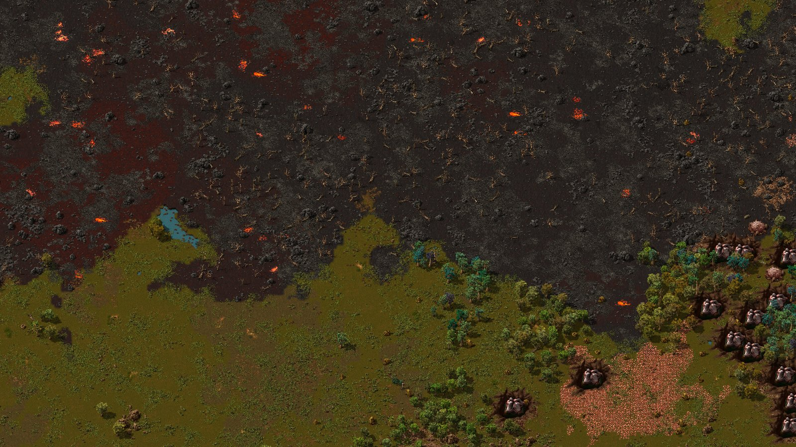
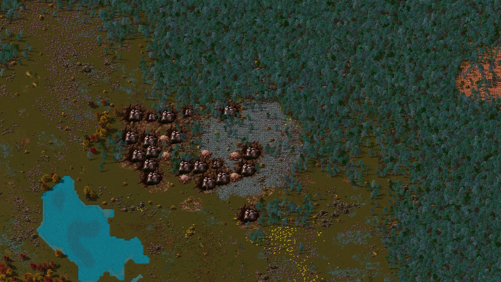
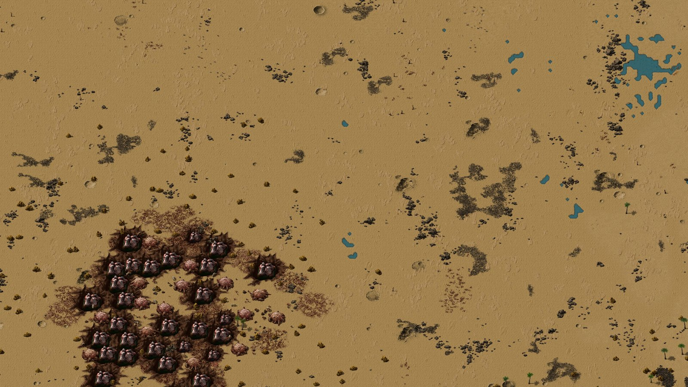
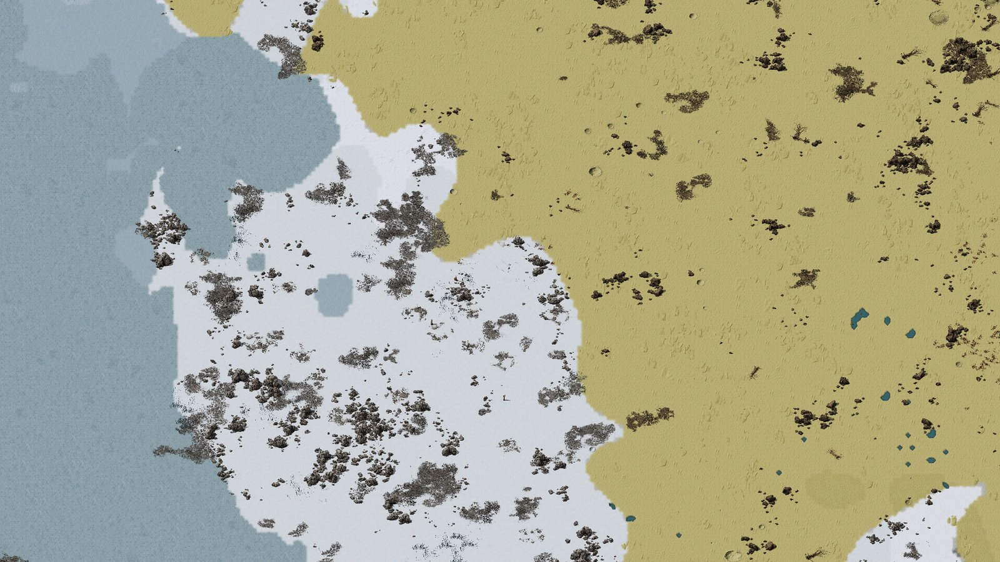
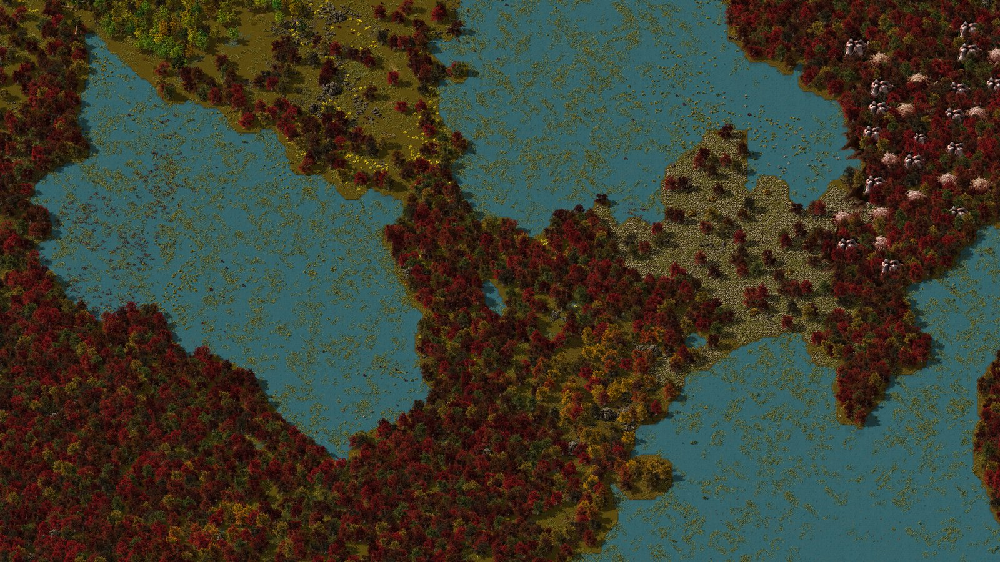
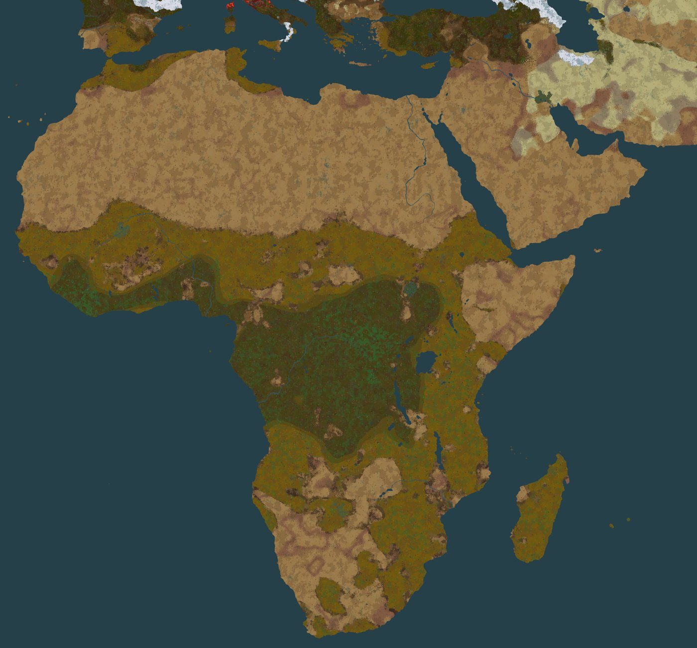

# Terra Nauvis

Terra Nauvis is a Factorio 2.1 mod that turns Nauvis into Earth. You pick one of three maps on the
new-game screen and start at a real city. The coastline, rivers, climate and mountain ranges are drawn
from a map of the real world, and the big ore fields sit where the real mines are.

Version 0.3.0, for Factorio 2.1.24 or newer. Space Age and Alien Biomes are optional.

*Old World at map scale 12: 107,556 x 70,164 tiles, seed 1000, spawn Frankfurt, with Alien Biomes,
Destroyed Europe and Blue corrupted UK and Australia on.*

## What you get

- **Three maps.** Europe; Atlantic, which is the whole world except Antarctica; and Old World, which
  is Europe, Africa, Asia and Australia. Each one sits in an endless deep ocean. Where a map's frame
  cuts through land, the coast forms bays and headlands instead of a straight line.
- **A size you pick.** Map scale sets how many tiles each pixel of the reference map becomes: 1 to 6,
  12 or 24. Old World at the default scale of 6 is 53,778 x 35,082 tiles.
- **A start at a real city.** Choose from 40 cities on Europe, 50 on Atlantic and 33 on Old World, or
  let the map seed pick. The start has land around it, a lake nearby, the base game's starting ore and
  no biters. A city in the cold north starts in a clearing off the snow. If the start holds less than
  90 percent of the base game's average starting coal (about 266,000 within 150 tiles), an extra
  patch brings it up to that average.
- **Rivers and canals.** Great rivers with walkable fords, from the Rhine and the Danube to the Nile,
  the Congo and the Amazon; Atlantic carves 32 of them. They are about 3 tiles wide at scale 1 and 12
  to 18 at scale 6. The Kiel,
  Corinth, Suez and Panama canals and the straits are at least 7 tiles wide, enough for Cargo Ships.
- **Earth's climate.** Sand desert in the Sahara, Arabia and Iran. Savanna and dry scrub in East
  Africa, the Karoo, the Cerrado and the Caatinga. Rain forest in the Congo, the Amazon, Borneo and
  New Guinea. Southern Scandinavia is green, and taiga runs across northern Europe and Siberia up to a
  snow line at about 64 to 70 degrees north. Biomes are about 1.5 times the size of the base game's.
- **Mountains.** Cliff ridges follow 10 ranges on Europe, 21 on Old World and 26 on Atlantic, from
  the Alps, the Pyrenees and the Himalayas to the Taurus, the Alborz, the Tian Shan, the Altai, the
  Ethiopian Highlands, the Great Dividing Range, the Sierra Nevada and the Cascades. Each has passes
  at its historic crossings and a gap at least every 400 km that fits a double track, and its cliffs
  stand as walls with short breaks. Big rocks and stony ground gather round each range, and high
  ranges carry snow and rock with a narrow, broken grey rim. Desert ranges such as the Atlas and the
  Zagros have no snow.
- **Ore.** Ordinary patches are the base game's own in size and shape. Their amount follows the base
  game's out to about 1,000 tiles from the spawn, then grows at half its pace and stops growing at
  about 4,000 tiles. Historic ore fields sit at their real sites, such as Kiruna, the Ruhr, the
  Donbas, Ghawar and the Copperbelt. A field holds three to six times a large base-game patch at the
  same distance, at most about 100 million. It stays two to three times as rich per tile as the
  ordinary ore round it and keeps a large footprint at any distance. Biter nests stand about three
  times as thick inside it.
- **Regional scarcity.** Past the start, ordinary ore thins out away from the regions where each
  resource is found on Earth, so the historic fields and the land round them are worth a rail line
  or a ship route. Whole patches drop out, uranium and oil most and stone least, and the ones that
  remain keep their size. Medium is the default; Off and Strong are in the settings.
- **Forests and marshes.** Great forests carry about twice the trees of the land around them, from
  the Black Forest and the taiga to the Congo, Borneo, New Guinea, the Appalachians and Valdivia, on
  the maps that hold them. Marshes include the Sundarbans, the Inner Niger Delta and the Mekong delta.
- **Two optional zones** for Alien Biomes players, both off by default. Destroyed Europe turns the
  middle of Europe into volcanic wasteland. Blue corrupted UK and Australia turns those two blue and
  purple.

## Screenshots

In-game shots at player zoom on Old World at map scale 12, with Destroyed Europe and Blue corrupted
on, Ore hotspot size at Large, and a pack of 82 mods that includes Space Age and Alien Biomes.

*Destroyed Europe at the Frankfurt spawn, zoom 1: cracked volcanic ground with lava pools. You can
walk and build on all of it.*

*The eastern edge of Destroyed Europe, zoom 0.25. Volcanic ground, lava pools and dead trees stop at
ordinary grassland, with no band in between along this stretch.*

*London with Blue corrupted UK and Australia on, zoom 0.25.*

*Kiruna, zoom 0.25: the iron ore of the Kiruna field out in the taiga, with the nests that guard it.*

*The Empty Quarter in Arabia, zoom 0.25.*

*The Alborz in northern Iran, zoom 0.25: snow, ice and rock fields next to the desert.*

*The Sundarbans, zoom 0.25: marsh pools between forested islands.*

*Europe, cut from the Old World render above. Destroyed Europe is the red zone, Britain is Blue
corrupted, and the far north is under snow.*

*Africa and the Middle East from the same render: the Sahara, Arabia and Iran, the Congo forest, and
savanna and dry scrub in the east and south.*

The map images are the game's own map preview, read every 6 tiles across the whole world and scaled
down. They show the tiles and trees the game places. Biter bases, rocks and cliffs are left out,
since at this size they would be drawn far too large.

## The three maps

World sizes are in tiles.

| Preset | What it covers | Scale 1 | Scale 6 | Scale 12 | Scale 24 | Spawn cities |
|---|---|---|---|---|---|---|
| Terra Nauvis: Europe | Europe from Portugal to western Russia and Turkey, with a strip of North Africa | 2,400 x 1,704 | 14,400 x 10,224 | 28,800 x 20,448 | 57,600 x 40,896 | 40 |
| Terra Nauvis: Atlantic | The whole world but Antarctica, centred on the Atlantic | 15,689 x 6,524 | 94,134 x 39,144 | 188,268 x 78,288 | 376,536 x 156,576 | 50 |
| Terra Nauvis: Old World | Europe, Africa, Asia and Australia | 8,963 x 5,847 | 53,778 x 35,082 | 107,556 x 70,164 | 215,112 x 140,328 | 33 |

Scales 2 to 5 fall in between: at scale N each pixel of the reference map becomes N by N tiles.

## Install

1. Download `terra-nauvis_<version>.zip` from the
   [latest release](https://github.com/jakemismas/terra-nauvis/releases/latest).
2. Put the zip in your mods folder. Do not unzip it, and keep only one `terra-nauvis_*.zip` there.
   - Windows: `%APPDATA%\Factorio\mods`
   - Linux: `~/.factorio/mods`
   - macOS: `~/Library/Application Support/factorio/mods`
3. Start Factorio, open **Mods**, check that Terra Nauvis is enabled, and confirm.

The release also carries `terra-nauvis_<version>.zip.sha256` to check the download against. The
repository's `latest` pre-release is rebuilt from the newest code on every push, so play on the
tagged release.

## Start a world

1. In the main menu, open **Settings > Mod settings > Startup**.
2. Set **Map scale**. 6 is the default. 12 and 24 make worlds two and four times as wide, and every
   trip there is long (Base game limits has the distances). Each value lists the world size of every
   map.
3. Set the spawn city for your map, such as **Spawn city: Old World**, or leave it on Random. Confirm,
   and let the game reload.
4. Open **Single player > New game**.
5. In the preset list at the top left, pick **Terra Nauvis: Old World**, Europe or Atlantic. The
   preview shows the map around your spawn.
6. Press **Play**. The intro names your spawn city and the world size.

Set everything before you press Play. A world made from a preset keeps its scale, spawn city and
every startup setting below for life, and a message tells you when a setting no longer matches.
Ore hotspot size and Regional scarcity are the exceptions: they give no message.

The presets set the Moisture and Terrain type sliders, and Alien Biomes' temperature sliders, to
150 percent scale, which is what makes the biomes larger. If you set them back to 100 percent, you
get smaller biomes.

The Terrain tab's **Map type** list also names the three maps. Picking only the map type gives you
that map's coast, rivers and spawn with the base game's climate and nothing else. Such a world also
follows later changes to the scale, spawn city, Canals, Inland lakes and Ore hotspots settings, which
moves any terrain it generates afterwards. Use the preset unless you want exactly that.

## Recommended settings

This is how we play, not the default. Set **Ore hotspot size** to Large, and on the new-game
screen's Resources tab lower each ore's **Frequency** to 50 percent. Ore near home gets sparse and
every historic field holds twice as many ore bodies, so the real deposits become worth the trip. The
mod's own default for the hotspot size stays at Normal.

## Settings

All of these are startup settings except City markers, which is on the Map tab and can change in a
running game. The tooltip of each optional layer gives its map generation cost at Old World scale 12.

| Setting | Default | What it does |
|---|---|---|
| Map scale | 6 | The size of the world: each pixel of the reference map becomes 1 to 6, 12 or 24 tiles. |
| Spawn city: Europe | Random | Where a Europe game starts: Random or one of 40 cities. |
| Spawn city: Atlantic | Random | Where an Atlantic game starts: Random or one of 50 cities. |
| Spawn city: Old World | Random | Where an Old World game starts: Random or one of 33 cities. |
| Canals | On | Opens the Kiel and Corinth canals on every map, Suez on Atlantic and Old World, and Panama on Atlantic, as sea-level channels at least 7 tiles wide that Cargo Ships can use. Off keeps every isthmus closed. |
| Great forests | On | Gives each great forest about twice the trees of the land around it, and the cold taiga forests more. Trees still follow the climate, so a forest in a dry place stays thinner. |
| Ridges | On | Places cliff ridges along the map's mountain ranges (10 on Europe, 21 on Old World, 26 on Atlantic). They are the only cliffs on the map. Passes sit at the historic crossings, with a gap at least every 400 km wide enough for a double track. No ridge crosses the starting area. Off gives a map with no cliffs. |
| Ore hotspots | On | Adds the historic ore fields: dense ore across a footprint that moves a little with the map seed, with about three times the base game's biter nests inside it, plus offshore oil fields on deep water when the Oil Rig mod is installed. On a solid ore field the map's size slider scales its area and total and the richness slider its ore per tile; the frequency slider does not reach it, and crude oil hotspots take only Ore hotspot size. Ordinary ore stays out of a hotspot's disc, and no field lies at a spawn city. Off gives the base game's ore alone. |
| Ore hotspot size | Normal | How much ground each ore hotspot covers: Small, Normal, Large or Huge. Normal: a field holds several large ordinary patches' worth of ore, up to about 100 million, in a few big ore bodies about twice as rich per tile as the ore around it. Large and Huge add more ore bodies (two and four times the ore); Small halves it. Richness per tile stays the same. Oil hotspots get richer wells instead. Applies to new worlds. |
| Regional scarcity | Medium | Makes ordinary ore patches rarer away from the regions where each resource is found on Earth. Only ore farther than about 1,500 tiles from the spawn at scale 12 changes (half that at scale 6), fading in to the full effect at about 3,000 tiles; the start, its starting ore and the hotspots stay the same. Whole patches drop out and the rest keep their size. Medium keeps about 20 percent of the uranium patches outside its regions, 35 percent of the oil, 50 of the copper, 65 of the iron, 75 of the coal and 95 of the stone; Strong keeps 8, 15, 30, 40, 55 and 80 percent. Off places ordinary ore as before. Applies to new worlds. |
| Inland lakes | Off | Scatters small random lakes across the land, about eight in every 1,024 x 1,024 tiles, away from coasts and the starting area. Off leaves only the lake at the spawn city, the rivers and the real lakes of the map. |
| Destroyed Europe | Off | Needs Alien Biomes. Turns the middle of Europe into volcanic wasteland: France, the Low Countries, Germany with Jutland and the north German coast, Switzerland, Austria, Poland, Slovenia to Ljubljana, Veneto, Friuli, western Istria and Italy down to about Rome, reaching the foothills of the Pyrenees. Most of it is cracked volcanic ground with lava pools and some black and red rock, and a great forest inside stands as a dead forest. Where the zone meets ordinary land it frays out through scorched red grass, black ash and red rock, in a band that changes width and breaks in places. Britain, the Danish islands and the Carpathians stay outside. You can walk and build on all of it at full speed, and it absorbs pollution like grass. Biter and worm creep and the dry plants inside turn ember red, and the zone shows red on the map view. Its outline changes with the map seed. A spawn city you choose inside the zone starts in it, on cooler ground; Random never picks one there. Without Alien Biomes nothing changes and the game warns you. |
| Blue corrupted UK and Australia | Off | Needs Alien Biomes. Turns the UK and Australia into Alien Biomes' blue and purple lands: mostly mauve grass with some blue grass, purple grass and purple dirt, and the violet, white and blue trees and plants that grow there. The Europe map holds the UK only. In Ireland the zone stops at the Northern Ireland border, which frays into normal ground. Alien Biomes' blue and purple lands appear nowhere else, with this setting on or off, and its green and olive plants do not grow inside the zone. Biter and worm creep and the brown plants and mud inside turn blue-purple. |
| Exact coastlines | On | On Atlantic and Old World at map scales 1 to 6, holds a new world's coast to the EarthMaps reference as chunks generate. It leaves out the coast beside rivers, straits and canals, the map's edge band and the 24 tiles round the spawn. Channels and islets narrower than a pixel come back, and land made from sea takes the trees and ground cover of the land beside it. The map preview still shows the noise coast. The Europe map, map scales 12 and 24, and worlds made from a Map type entry alone keep the noise coast. |
| City markers | Off | Names every city of the map on the map view. It changes nothing in the world, so you can switch it at any time. Worlds made from a Map type entry alone get no markers. |

## Compatibility

- **Alien Biomes:** optional. With it, the ground follows real regions: green rain forest, golden
  sand desert, pale sand and gravel across Central Asia, dry yellow steppe, cold grey Tibet, a
  snowbound far north and a white Greenland. Temperate Europe keeps its ground, and the base game's
  trees, rocks and plants grow beside Alien Biomes' own. Palms grow on warm, low ground south of
  about 35.5 degrees north and in groves on warm Mediterranean shores, from Spain to Greece and
  Turkey's south coast; inland Europe has none. Outside the Blue corrupted zone, Alien Biomes' blue,
  teal and purple ground and plants are swapped for green, brown or orange ones. Without Alien Biomes,
  the base game's tiles follow the climate, and a frozen tile of Terra Nauvis's own covers the far
  north and the snowy massifs. Destroyed Europe and Blue corrupted UK and Australia need Alien Biomes.
- **Grey cliffs beside Alien Biomes:** with both mods on, every Nauvis world uses Alien Biomes' grey
  stone cliff art, including default worlds and older saves. Only the look changes; no cliff moves.
- **Space Age:** works, not required. Terra Nauvis changes Nauvis only, so the other planets
  generate as usual. The one difference seen is a single plant on Gleba, which the game moves in any
  save whose Nauvis differs from the default. Tree farms can plant on the base game's grass, dirt,
  sand and desert that Terra Nauvis puts back beside Alien Biomes, and on both zones' ground.
- **RSO:** not supported. RSO replaces the map's ore with its own, so you do not get the designed
  start, ore hotspots may not match the map, and the preview shows no ore. Where RSO's start is short
  of an ore, Terra Nauvis adds a patch, unless RSO's Ore in starting area setting is off. The game
  warns you at the start and carries on.
- **Cargo Ships and its Oil Rig:** straits and canals are wide enough for ships at every scale, and
  rivers at scale 6. Offshore oil fields appear on deep water when the Oil Rig mod is installed.
- **Large packs:** a world in a pack will not match the screenshots on this page, since packs change
  ore, enemies and looks. The next section has the details.

## Playing with Space Age and big packs

We test with a pack of 82 mods: Space Age with Quality, Elevated Rails and Recycler, Alien Biomes,
Cargo Ships with its Oil Rig, Bob's Enemies, Big Monsters, Combat Mechanics Overhaul, Dectorio, an
admin tools mod and a set of graphics and quality-of-life mods, with RSO off. 0.3.0 loads in it with
no errors and runs ten game minutes clean.

- **Terrain does not change.** In the map preview a world in the pack has the same coasts, rivers,
  ground and trees as one made beside Alien Biomes alone. Only ore and biter bases differ.
- **Ordinary ore moves.** The Oil Rig adds ore patches of its own, so every ordinary patch lands
  somewhere else for the same seed. Every start still gets all of its starting ore. Offshore oil
  keeps the Oil Rig's own richness, which grows with distance, so it runs richer at scales 12 and 24
  than at 6.
- **Biter bases change their look, not their place.** Bob's Enemies puts its spawners where the base
  game's would stand, and its worms and Big Monsters' worms follow the same layout.
- **Sand-coloured rocks on snow are Bob's Enemies' worm bile.** Its worms leave clusters of hardened
  bile 30 to 60 tiles around them, and on snow they stand out. They are not part of the terrain.
- **Graphics mods repaint, they do not move anything.** A terrain or decoration graphics mod changes
  how tiles, rocks and plants look; the shapes stay.
- **Memory.** A graphical game with this pack used about 12 GB on a fresh map, and every 180,000
  generated chunks (a square about 13,600 tiles wide) add about 4.5 GB.
- **Multiplayer.** A dedicated server and one client, both running the pack, played 15 minutes of Old
  World at scale 6 with the client travelling about 10,700 tiles: no desync and no script error.

## Known issues

- **Worlds made before 0.3.0 do not load.** Each map now keeps only its 0.3.0 terrain, which makes
  the game start about 4.5 seconds faster with a large pack. Start a new world.
- **Multiplayer has had one kind of test**, the 15-minute run above. Larger games and games longer
  than 15 minutes are untested.
- **Map sliders.** The water and cliffs sliders do not change an Earth map: the coast stays, and
  ridges are the only cliffs. A world started with cliffs at none gets its ridges back beyond the
  starting area. On solid ore hotspots the size slider scales a field's area and total and the
  richness slider its ore per tile; the frequency slider does not reach them, and crude oil hotspots
  take only the Ore hotspot size setting. The other sliders work.
- **Hotspot totals vary.** Each field's total is capped by its strength, at most about 100 million,
  and varies around its design. A field whose disc has little land, such as a small or coastal
  footprint, holds less.
- **The Europe map has the weakest coast of the three.** Exact coastlines does not run on it, so its
  noise coast strays further from the reference. Old World gives you a closer Europe.
- **Coasts at scales 6, 12 and 24 still show steps.** At scale 6 some coasts that Exact coastlines
  writes step in squares along the reference's pixel edges, at Calais, Brittany, the Cotentin and
  Sydney among others. At 12 and 24, where Exact coastlines does not run, a coast can step every 12 or
  24 tiles, and a fold of the coast can leave a tiny islet of a few tiles off a headland. At 12,
  straight runs of 7 to 10 tiles remain on the Rhine and the Thames. At 24 the Rhine near Koblenz keeps
  a long straight bank, and its fords there show as straight-sided pale shallow slabs.
- **Coasts and rivers at scales 1 and 2 are smoother, not perfect.** A straight run of 8 to 11 tiles
  still shows here and there. Thin features such as Zeeland's narrow islands merge or thin, small
  islets such as Mont-Saint-Michel are gone, a channel the map draws straight stays straight (the
  Nieuwe Waterweg at scale 2, the Thames strait on Atlantic at scale 1), and a few ponds of 5 to 16
  tiles appear where the reference holds a lake under a pixel or two.
- **A coast is only as fine as its reference.** The reference holds one pixel per 2.5 km or so, at
  every scale and on every continent, so a written coast follows it to within a tile or two and shows
  nothing finer. Islets under a pixel are drawn a pixel wide. A channel narrower than a pixel opens
  only where the reference shows one, and the coast beside a river or strait keeps the noise's line.
- **Written coast can stay bare.** Land that Exact coastlines writes copies the trees and ground
  cover of the land beside it. A chunk with no land of its own copies a neighbour, so if that
  neighbour generates later, the new land stays bare. Written land holds no ore or biter bases, so
  where it fills sea beside an ore field, the field ends in a straight line at the old coast.
- **Ships need scale 6 on rivers.** Rivers at scales 1 to 3 are too thin for ships, and scales 4 and
  5 were not checked. At every scale a river thins to a stream at its source.
- **A few rivers break for a short stretch.** At some seeds and scales a short upper piece of a river
  stands apart from the rest: the Neman at Atlantic scale 2 and Old World scale 5, the Guadalquivir at
  Old World scale 4, the Euphrates or the Neman at some seeds at scale 6. A thin channel opened from
  the sea can end abruptly about 240 tiles inland at scale 6. A tributary the reference draws can end
  a few dozen tiles short of the river it joins.
- **Some shapes still look computer-made.** Up close a ridge has short hooks, and where it bends hard
  it can fold into a short gate or near ring. A wide range shows a main line and a side line running
  together. Greenland and Arctic Canada read as long east-west streaks. In the far north, snow and ice
  can meet in straight seams, and beside Alien Biomes the base game's sand-coloured rocks and decals
  also lie on dry snow there.
- **Destroyed Europe has blocky edges in places.** On the Europe map at scale 6 the zone's ground
  meets dark ground in stepped blocks at Calais and in Brittany, and the Calais shore runs straight
  for about 25 tiles.
- **Biter bases can still pair up.** Two spawners can stand side by side, and worms can line up
  loosely inside one base.
- **New chunks cost more than in the base game.** On Old World at scale 6, at Frankfurt, a block of
  25 x 25 chunks takes about 1.2 to 1.4 times as long to generate as in the base game, and 1.2 to 1.3
  times as long as with Alien Biomes alone. Moving fast into new land can bring short stalls. Nothing
  runs per tick once chunks exist. Terra Nauvis also adds a few seconds to the game's startup.
- **Adding the mod to an existing save changes nothing there**, apart from the grey cliff art beside
  Alien Biomes.
- **A default world beside Alien Biomes changes slightly.** With Terra Nauvis loaded, a new world on
  the default preset beside Alien Biomes has the same tiles, but about one tree in a hundred is
  another Alien Biomes species and a few decals move.
- **Most cities stand where EarthMaps put them.** On Atlantic and Old World a city sits at EarthMaps'
  own map point, which can lie far from the real place. Prague, Frankfurt, Aachen and Moscow on Old
  World stand at their real positions.
- **Testing.** 0.3.0 created and ran 48 new worlds (the three maps at scales 1, 6, 12 and 24, with and
  without Alien Biomes and Destroyed Europe) and ran the pack soak on Old World at scale 6: 33 runs of
  far travel, long simulation and save and load, 27,242 chunks and 170 game minutes, all stable.
- **Not on the Mod Portal.** The GitHub release is the only source.

## Base game limits

These come from Factorio itself, and no mod can change them.

- **Square tiles.** Coasts, rivers and borders are drawn in square tiles, so a diagonal edge steps one
  tile at a time.
- **Hard map edges.** The map does not wrap: its far east and far west never meet, and past the
  reference map's frame lies endless deep ocean. On Atlantic the Pacific is cut in two at the map's
  ends.
- **Long distances at large scales.** In a straight line Moscow lies about 7,960 tiles from Frankfurt
  at scale 6, about 15,900 at scale 12 and about 31,800 at scale 24. At the base running speed of
  about 9 tiles a second that is about 15, 30 and 60 minutes on foot.
- **Save size and memory.** The game keeps every generated chunk in the save and in memory. A square
  of about 13,600 tiles round the spawn, 180,000 chunks, saves to about 220 MB and holds about 4.5 GB
  of RAM in a big pack. A whole Old World holds about 1.8 million chunks at scale 6 and 29 million at
  scale 24, so a game only ever generates a small part of it.
- **No elevation.** Mountains show as rock and snow ground with cliff ridges and passes, never as
  hills.
- **Still water.** Water does not flow, so a river is a channel of still water.
- **Biters expand anyway.** Biter expansion follows the base game's map settings, so new bases spread
  onto land Terra Nauvis left free, the starting area included, unless expansion is off.
- **The new-game preview is small.** No mod can change its size, so it shows only the area around the
  spawn, never a whole map at a large scale.
- **The new-game preview cannot show Exact coastlines.** Exact coastlines is a script that runs as
  chunks generate, and no mod can run a script on that screen. Old World and Atlantic show their noise
  coast there, coarser than the world you get, most of all away from Europe. At scales 12 and 24, and
  with Exact coastlines off, the noise coast is the world's coast.
- **A generated chunk never changes.** That is why a world keeps its startup settings for life: it
  has to keep making new chunks the way it began.

## License and credits

Terra Nauvis is by Jake Mismas, under the GNU General Public License version 3: see `LICENSE` and
`NOTICE.md`, and `terra-nauvis/SOURCE-OFFER.txt` for how to get the source. Its maps derive from
[EarthMaps](https://github.com/HySpeed/EarthMaps) by HySpeed, also GPLv3. Forests, marshes and islets
derive from [RESOLVE Ecoregions 2017](https://ecoregions.appspot.com/) by Dinerstein et al., under
[CC BY 4.0](https://creativecommons.org/licenses/by/4.0/). Canal routes use data
(c) [OpenStreetMap](https://www.openstreetmap.org/copyright) contributors, under the Open Database
License. Base game expression texts in `terra-nauvis/prototypes/tables/vanilla.lua` belong to Wube
Software and are not under the GPL.

The hotspots' places and sizes are facts, listed with their sources in
`data-src/hotspots/deposits-research.md`. Its country tables quote the USGS Mineral Commodity
Summaries 2026 data release, a United States government work in the public domain. No dataset ships
in the mod. The screenshots in `docs/images` were taken in the game and show the art of Factorio,
Alien Biomes and the other mods of the test pack. Factorio is a trademark of Wube Software Ltd.; this is an unofficial mod.

## For developers

`python tools/earth_test.py static` runs the static checks and `python tools/build_zip.py` builds the
zip. The offline body checks and `build_zip.py --release` read `tests/vanilla-raw.json`, the base
game's prototypes: `python tools/make_vanilla_raw.py --dump <base-only data-raw-dump.json>` makes it
from an installed Factorio 2.1. `TESTING.md` is the release smoke test, `CHANGELOG.md` the build
record, and `ARCHITECTURE.md` and the design notes hold the design.
