# Terra Nauvis

Terra Nauvis turns Nauvis into Earth. You pick one of three maps and start at a real city: Europe
(Portugal to western Russia), Atlantic (the whole world but Antarctica) or Old World (Europe, Africa,
Asia and Australia). Coasts, rivers, climate, mountain ranges and the big ore fields come from a map
of the real world. Great rivers have walkable fords, the Kiel, Corinth, Suez and Panama canals are
open to ships on the maps that hold them, and the start has a lake, the base game's starting ore
and no biters. Biomes are about 1.5 times the size of the base game's. Version 0.3.0 needs Factorio
2.1.24 or newer. Alien Biomes and Space Age are optional.

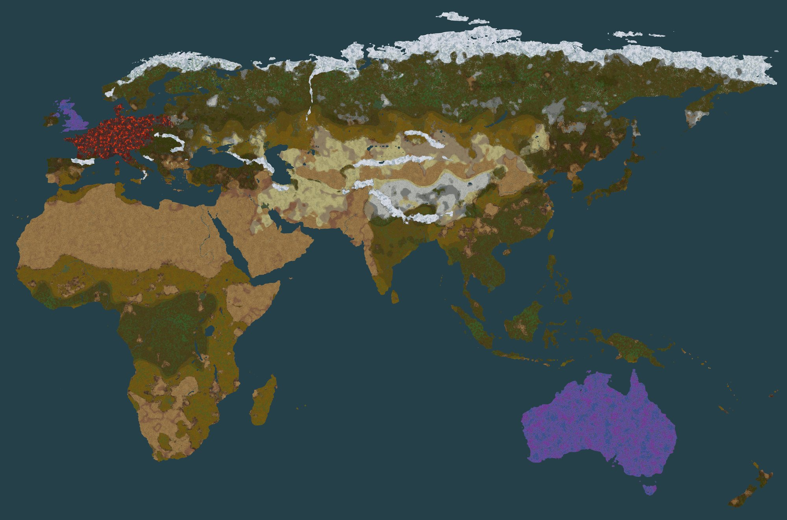

*Old World at map scale 12: 107,556 x 70,164 tiles. Seed 1000, with Alien Biomes, Destroyed Europe
and Blue corrupted UK and Australia on.*

## Pictures

All at map scale 12 with Alien Biomes. Ten are in-game shots at player zoom, most of them in a
large mod pack, and two are crops of the map above.

<table>
<tr>
<td width="50%">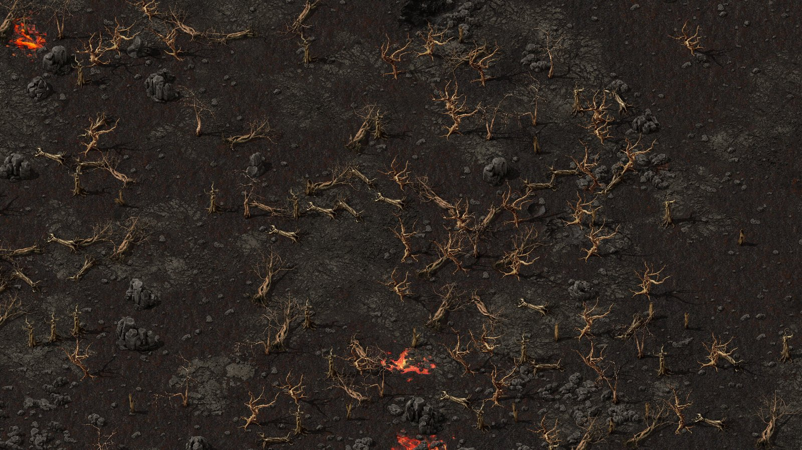 Destroyed Europe: volcanic ground, lava pools and the dead Black Forest.</td>
<td width="50%">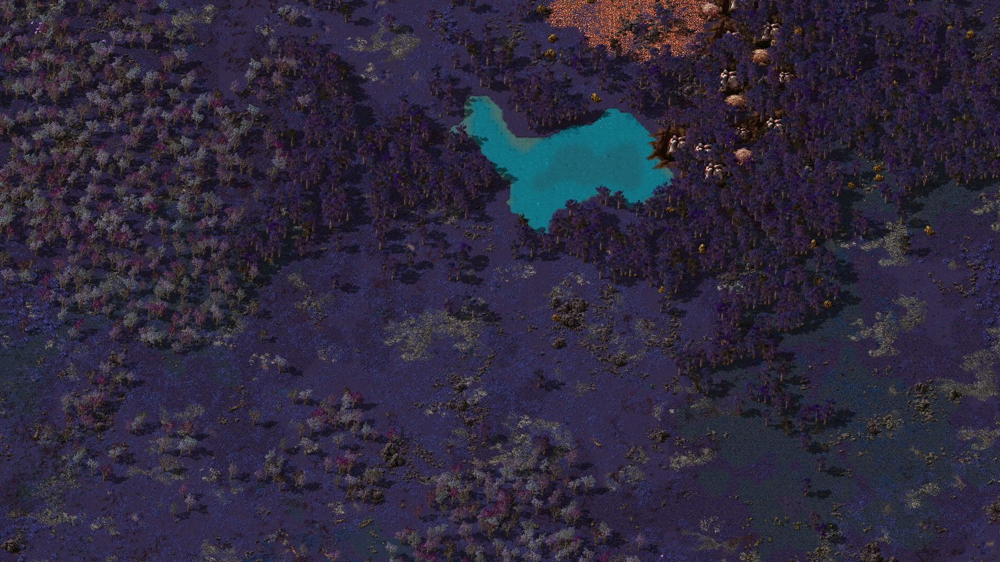 Blue corrupted UK: mauve forest and a lake near London.</td>
</tr>
<tr>
<td width="50%">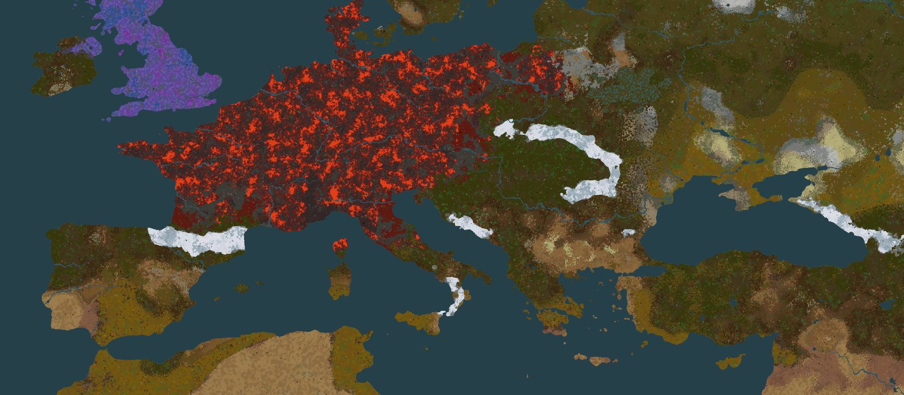 Map view: Destroyed Europe in red, the blue UK, snow on the Alps, Pyrenees and Carpathians.</td>
<td width="50%">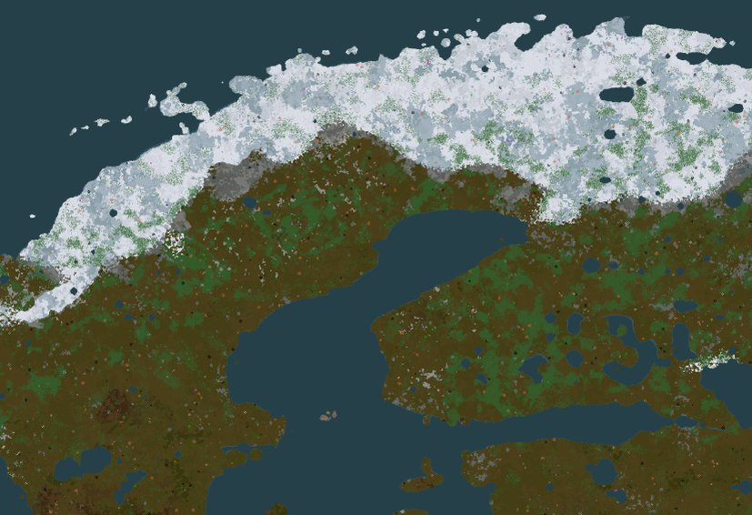 Map view: green Sweden and Finland up to the snow line at about 64 to 70 degrees north.</td>
</tr>
<tr>
<td width="50%">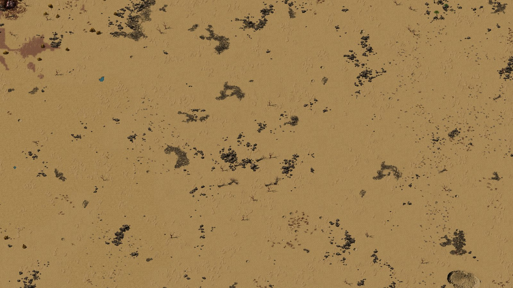 The Sahara: sand desert with rock and dry scrub.</td>
<td width="50%">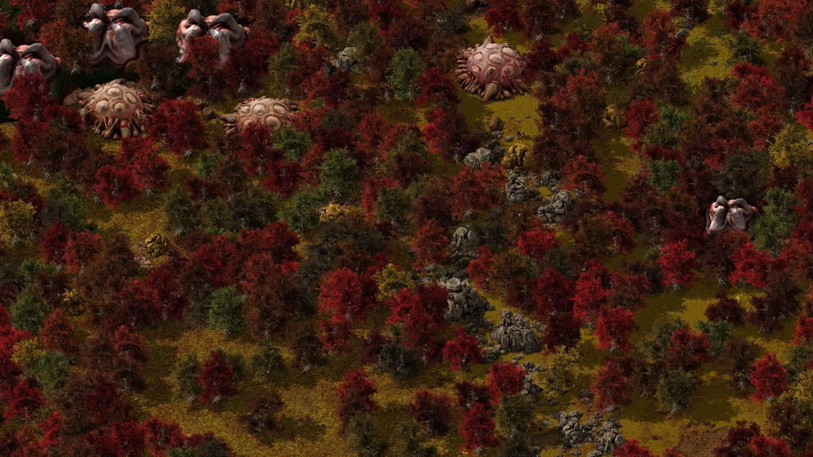 East Africa: savanna trees on dry grass, with a biter base.</td>
</tr>
<tr>
<td width="50%">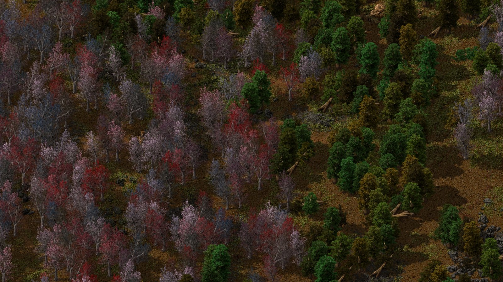 Siberian taiga: birch and spruce.</td>
<td width="50%">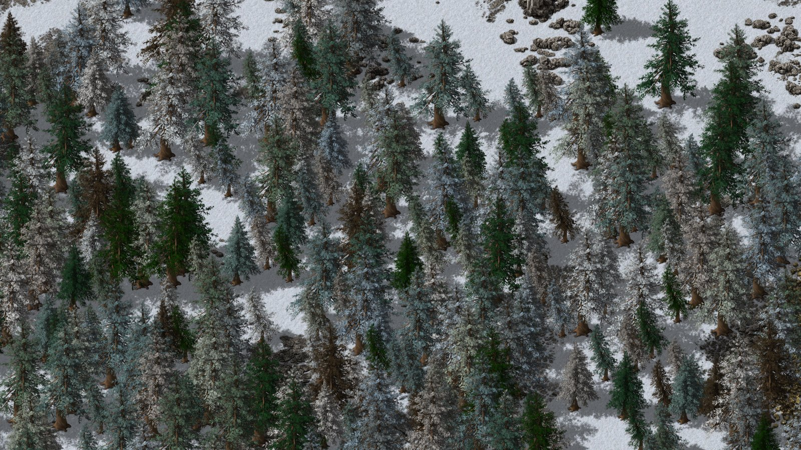 Taiga under snow in northern Russia.</td>
</tr>
<tr>
<td width="50%">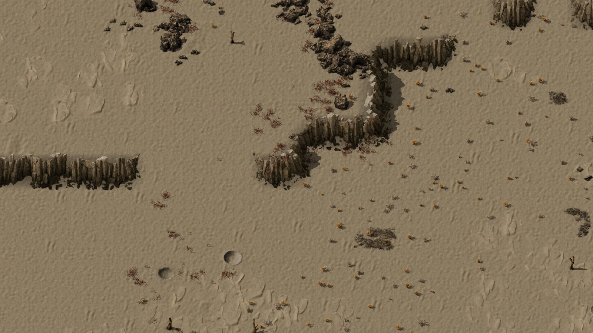 Cliffs of the Gobi Altai. Every range has passes at its historic crossings.</td>
<td width="50%">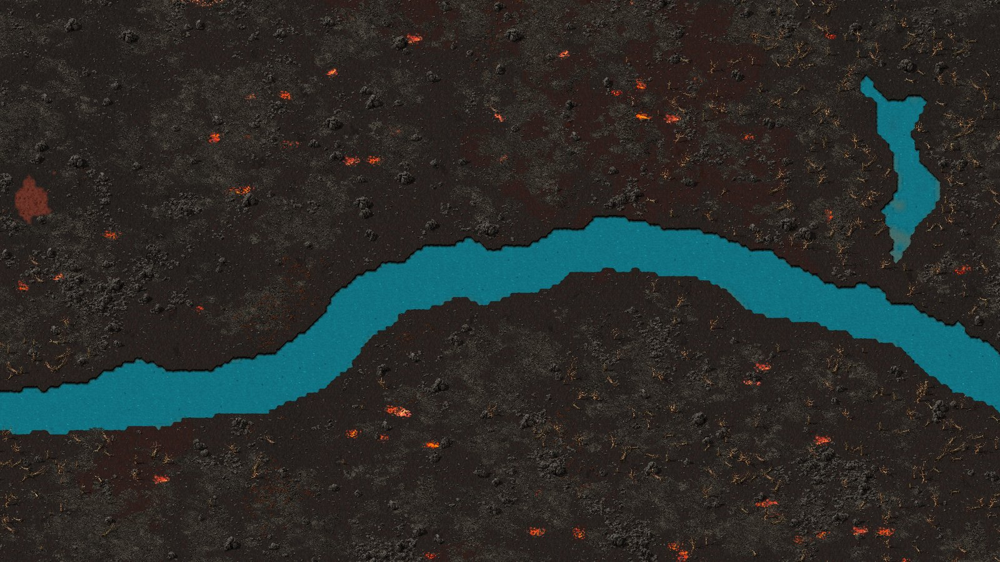 A winding river inside Destroyed Europe, Atlantic map.</td>
</tr>
<tr>
<td width="50%">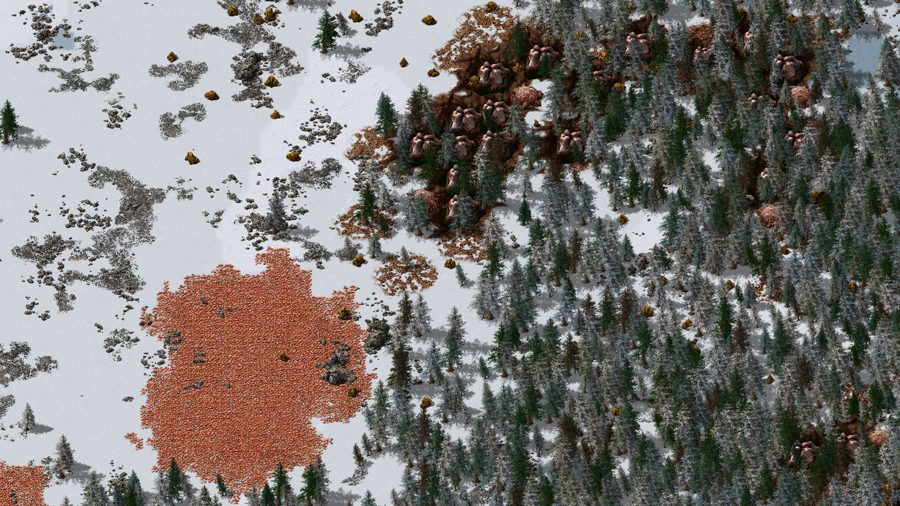 One ore body of the Norilsk copper hotspot, deep in the taiga.</td>
<td width="50%">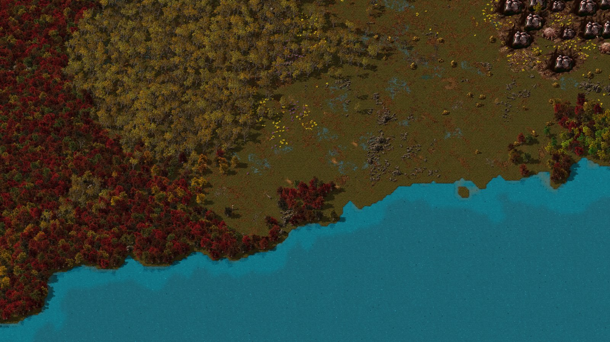 The Amazon mouth, Atlantic map: rain forest down to the shore.</td>
</tr>
</table>

## Install

1. Download `terra-nauvis_<version>.zip` from the
   [Releases page](https://github.com/jakemismas/factorio-terra-nauvis/releases/tag/v0.3.0).
2. Put the zip in your mods folder. Do not unzip it.
   - Windows: `%APPDATA%\Factorio\mods`
   - Linux: `~/.factorio/mods`
   - macOS: `~/Library/Application Support/factorio/mods`
3. Install Alien Biomes from the mod portal if you want Destroyed Europe or Blue corrupted UK and
   Australia. Both need it.

Terra Nauvis is not on the mod portal. In multiplayer every player needs the same zip in their mods
folder, because Factorio's mod sync only fetches mods from the portal. When another player joins, Factorio
downloads the host's other mods, such as Alien Biomes, from the portal.

To start a world, set the startup settings below under **Settings > Mod settings > Startup**, then
pick **Terra Nauvis: Old World**, Europe or Atlantic in the preset list on the new-game screen. A
world keeps its startup settings for life, so set them before you press Play. Worlds made before
0.3.0 do not load.

Large scales mean long trips. Moscow is about 7,960 tiles from Frankfurt at scale 6 and about 15,900
at scale 12, roughly 15 and 30 minutes on foot.

## Settings

| Setting | Default | What it does |
|---|---|---|
| Map scale | 6 | Tiles per pixel of the reference map: 1 to 6, 12 or 24. Old World is 53,778 x 35,082 tiles at 6. |
| Spawn city (one per map) | Random | Start at one of 40 cities on Europe, 50 on Atlantic or 33 on Old World. |
| Canals | On | Opens the Kiel, Corinth, Suez and Panama canals where the map has them, at least 7 tiles wide. |
| Great forests | On | The 22 great forests of Earth get about twice the trees of the land around them, more in the taiga. |
| Ridges | On | Cliff ridges along the real mountain ranges (10 on Europe, 21 on Old World, 26 on Atlantic), with passes. They are the only cliffs. |
| Ore hotspots | On | Big ore fields at real mines, and offshore oil fields with the Oil Rig mod. |
| Ore hotspot size | Normal | Small, Normal, Large or Huge: how much ground each hotspot covers. Large and Huge add ore bodies; richness per tile stays the same. Oil hotspots get richer wells. |
| Regional scarcity | Medium | Off, Medium or Strong. Past about 1,500 tiles from your spawn at scale 12 (half that at scale 6), whole regular ore patches drop out away from the regions that really have them: uranium and oil most, stone least. The patches that remain keep their size, and hotspots are unchanged. |
| Inland lakes | Off | Small random lakes, about eight in every 1,024 x 1,024 tiles. |
| Destroyed Europe | Off | Needs Alien Biomes. Volcanic wasteland from France to Poland and down to about Rome, with Jutland and the north German coast inside and Britain and the Danish islands outside, with lava pools and dead forests. You can walk and build on all of it. |
| Blue corrupted UK and Australia | Off | Needs Alien Biomes. Turns the UK and Australia blue and purple. |
| Exact coastlines | On | Holds the coast to the reference map on Old World and Atlantic at scales 1 to 6. |
| City markers | Off | Names the map's cities on the map view. You can switch it in a running game. |

On a solid ore hotspot the map's ore size slider scales the field's area and total, and the
richness slider its ore per tile. The frequency slider does not reach hotspots, and oil hotspots
take only Ore hotspot size.

How we play: Old World at scale 12 with both zones on, Ore hotspot size Large, and each ore's
Frequency at 50 percent on the Resources tab.

## Ore

The start has the base game's starting ore, and a start short on coal gets topped up to the base
game's average. Regular ore patches are the base game's own. Past about 1,000 tiles from the spawn
their amount grows at half the base game's pace, and from about 4,000 tiles it stops growing.
With Regional scarcity on, past about 1,500 tiles they also thin out away from the regions that
really hold that ore. Hotspots are large, rich fields at the real mines, such as Kiruna, the Ruhr, the Donbas, Ghawar,
Norilsk and the Copperbelt. A field holds three to six times a large base-game patch at its distance,
at most about 100 million. It stays two to three times as rich per tile as the ordinary ore round it
and keeps a large footprint at any distance, so it is worth the trip.

## Compatibility

- **Alien Biomes:** optional. With it the ground follows real regions, and the two zones need it.
- **Space Age:** works. Terra Nauvis changes Nauvis only.
- **Cargo Ships and its Oil Rig:** canals and straits fit ships at every scale, rivers from scale 6. The Oil Rig adds offshore oil fields.
- **RSO:** not supported. It replaces the map's ore with its own.

## License and credits

Terra Nauvis is by Jake Mismas, under the GNU General Public License version 3: see `LICENSE` and
`NOTICE.md`, and `terra-nauvis/SOURCE-OFFER.txt` for how to get the source. Its maps derive from
[EarthMaps](https://github.com/HySpeed/EarthMaps) by HySpeed, also GPLv3. Forests, marshes and islets
derive from [RESOLVE Ecoregions 2017](https://ecoregions.appspot.com/) by Dinerstein et al., under
[CC BY 4.0](https://creativecommons.org/licenses/by/4.0/). Canal routes use data
(c) [OpenStreetMap](https://www.openstreetmap.org/copyright) contributors, under the Open Database
License. Base game expression texts in `terra-nauvis/prototypes/tables/vanilla.lua` belong to Wube
Software and are not under the GPL.

The hotspots' places and sizes are facts, listed with their sources in
`data-src/hotspots/deposits-research.md`. Its country tables quote the USGS Mineral Commodity
Summaries 2026 data release, a United States government work in the public domain. No dataset ships
in the mod. The screenshots in `docs/images` were taken in the game and show the art of Factorio,
Alien Biomes and the other mods of the test pack. Factorio is a trademark of Wube Software Ltd.; this is an unofficial mod.
